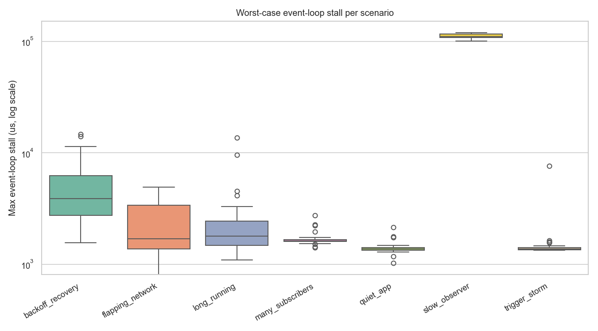
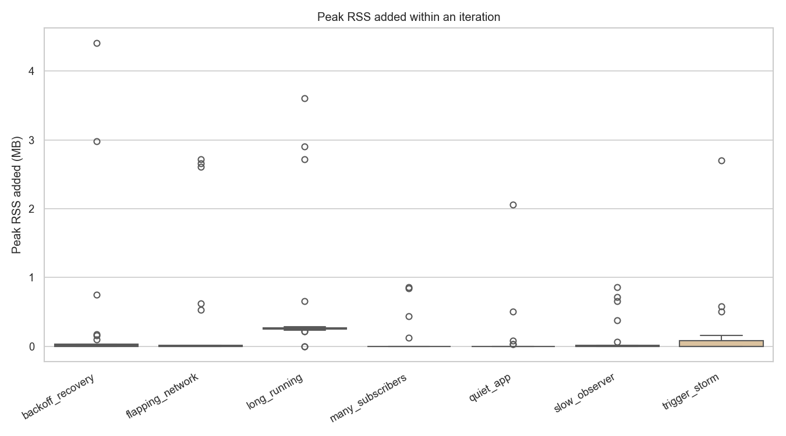
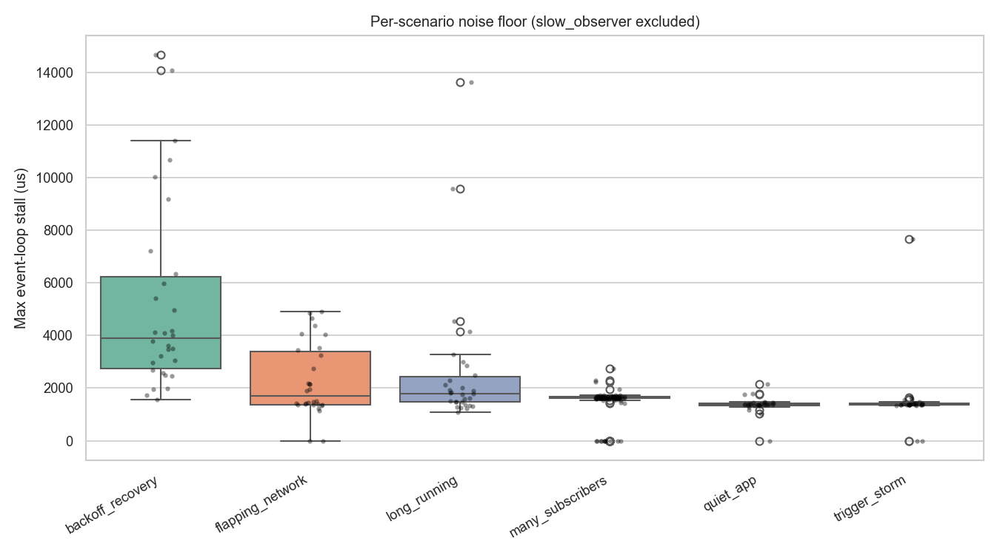
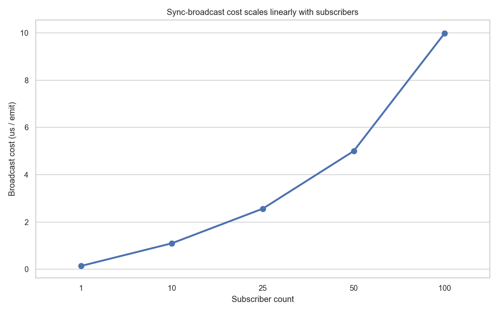

# Benchmark results

Captured **2026-11-21** against `1.1.0` at `11d668f` on Dart SDK 3.14.0. N=30 iterations per scenario.

> Per-machine measurements. Numbers below reflect *this* machine (CPU, GC, OS scheduler, thermal state). Your numbers WILL differ - capture your own local baseline before measuring a code delta.

## Headline: worst-case event-loop stall per scenario

Longest single continuous window in which synchronous work blocked the event loop (gap between 1 ms heartbeats, minus the heartbeat interval). The `slow_observer` scenario wires a deliberately-misbehaving observer that sleeps 50 ms per callback, which no dispatch strategy can mask on a single-threaded isolate. Expect about twice that here: the opening check fires a status change and a check-completed callback in the same turn, and every later window holds one. The other scenarios show the package's intrinsic noise floor.

| Scenario | N | Median (us) | IQR (us) | Min (us) | Max (us) |
|---|---:|---:|---:|---:|---:|
| `backoff_recovery` | 30 | 3,902 | 3,655 | 1,564 | 14,656 |
| `flapping_network` | 30 | 1,704 | 2,085 | 0.000 | 4,913 |
| `long_running` | 30 | 1,800 | 1,012 | 1,095 | 13,628 |
| `many_subscribers` | 90 | 1,625 | 56.00 | 0.000 | 2,747 |
| `quiet_app` | 30 | 1,378 | 77.00 | 0.000 | 2,150 |
| `slow_observer` | 30 | 110,489 | 8,753 | 101,096 | 119,281 |
| `trigger_storm` | 30 | 1,376 | 60.00 | 0.000 | 7,668 |

## Event-loop blocked share per scenario

`blocked_duty_ratio` is total stalled time divided by the measured window - the duration-independent 'how bad is it overall' number. For `slow_observer` expect roughly delay / check-interval (~50%); everything else should be near zero.

| Scenario | N | Median (%) | IQR (%) | Min (%) | Max (%) |
|---|---:|---:|---:|---:|---:|
| `backoff_recovery` | 30 | 0.07% | 0.06% | 0.01% | 0.19% |
| `flapping_network` | 30 | 0.03% | 0.04% | 0.00% | 0.07% |
| `long_running` | 30 | 0.01% | 0.01% | 0.00% | 0.12% |
| `many_subscribers` | 90 | 0.05% | 0.00% | 0.00% | 0.29% |
| `quiet_app` | 30 | 0.03% | 0.00% | 0.00% | 0.06% |
| `slow_observer` | 30 | 56.58% | 0.59% | 55.70% | 57.53% |
| `trigger_storm` | 30 | 0.03% | 0.00% | 0.00% | 0.24% |

## Peak RSS added per iteration

How far RSS climbed above where the iteration found it. Zero is the normal reading, not a sign the iteration was free.

| Scenario | N | Median (MB) | IQR (MB) | Min (MB) | Max (MB) |
|---|---:|---:|---:|---:|---:|
| `backoff_recovery` | 30 | 0.02 | 0.03 | 0.00 | 4.41 |
| `flapping_network` | 30 | 0.00 | 0.02 | 0.00 | 2.72 |
| `long_running` | 30 | 0.25 | 0.02 | 0.00 | 3.61 |
| `many_subscribers` | 90 | 0.00 | 0.00 | 0.00 | 0.86 |
| `quiet_app` | 30 | 0.00 | 0.00 | 0.00 | 2.06 |
| `slow_observer` | 30 | 0.00 | 0.02 | 0.00 | 0.86 |
| `trigger_storm` | 30 | 0.00 | 0.08 | 0.00 | 2.70 |

## Stability: noise floor across scenarios (slow_observer excluded)

Same metric as the headline chart, but with the `slow_observer` outlier excluded so the y-scale is readable. A narrow box = the metric is reproducible iteration-to-iteration.

| Scenario | N | Median (us) | IQR (us) | Min (us) | Max (us) |
|---|---:|---:|---:|---:|---:|
| `backoff_recovery` | 30 | 3,902 | 3,655 | 1,564 | 14,656 |
| `flapping_network` | 30 | 1,704 | 2,085 | 0.000 | 4,913 |
| `long_running` | 30 | 1,800 | 1,012 | 1,095 | 13,628 |
| `many_subscribers` | 90 | 1,625 | 56.00 | 0.000 | 2,747 |
| `quiet_app` | 30 | 1,378 | 77.00 | 0.000 | 2,150 |
| `trigger_storm` | 30 | 1,376 | 60.00 | 0.000 | 7,668 |

## Subscriber scaling: broadcast cost vs N listeners

From the `status_emission` micro (synchronous broadcast, isolated from the rest of the package). Production `InternetConnection` uses async-default broadcast where the producer pays a constant cost regardless of N; this chart isolates the per-listener *delivery* cost.

| Subscribers | N | Median (us/emit) | IQR (us) |
|---:|---:|---:|---:|
| 1 | 30 | 0.140 | 0.002 |
| 10 | 30 | 1.11 | 0.017 |
| 25 | 30 | 2.58 | 0.021 |
| 50 | 30 | 5.02 | 0.033 |
| 100 | 30 | 10.03 | 0.086 |

