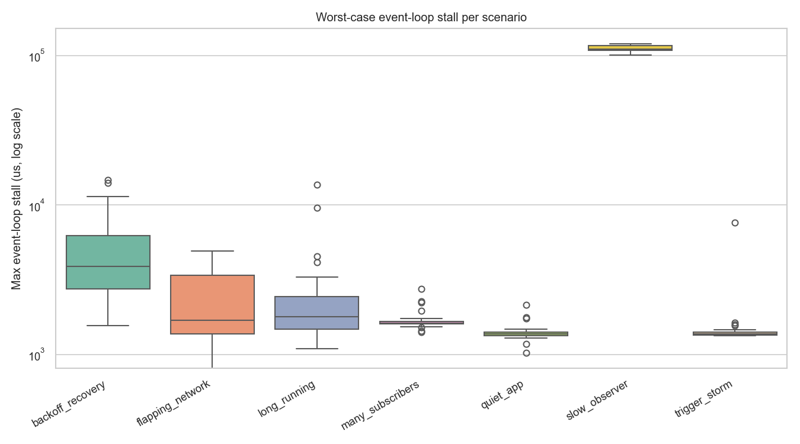
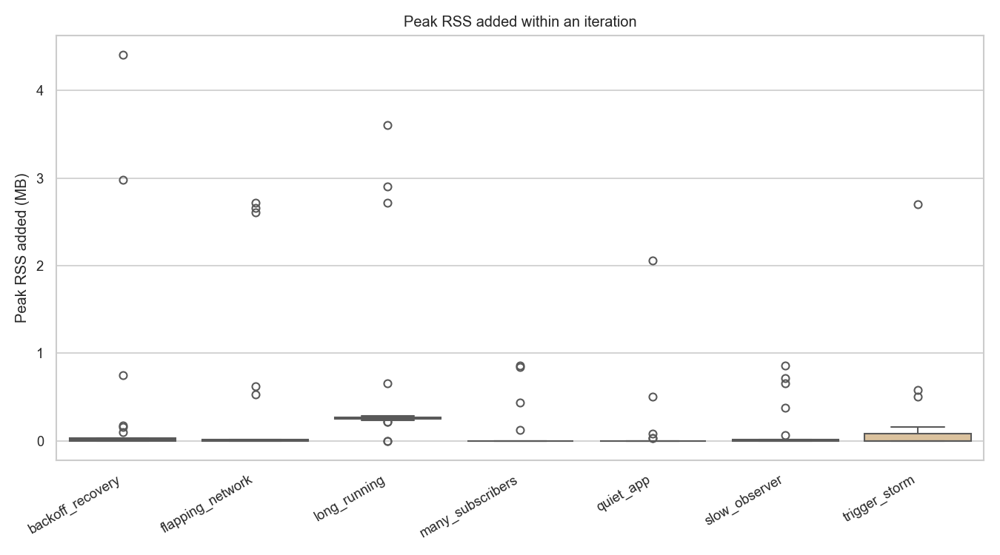
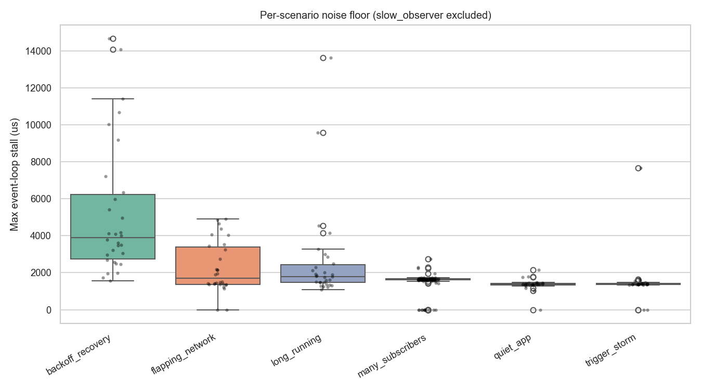
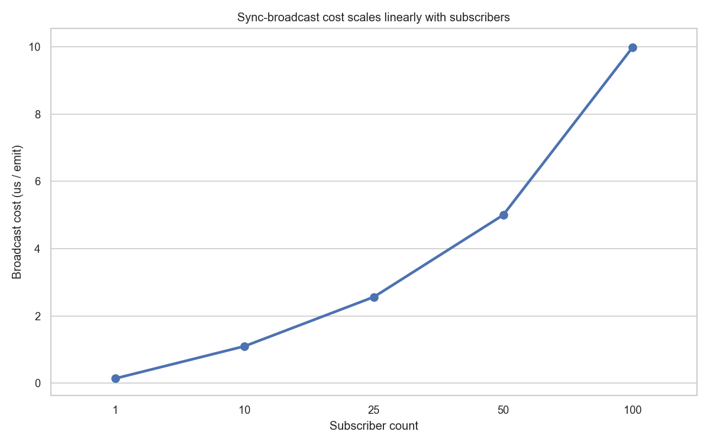

# Costs

What this package costs at runtime, and where each number came from. Every figure carries the date
it was taken, so a rerun replaces one outright instead of being averaged into it.

The per-scenario tables live in [`benchmark/reports/SUMMARY.md`](../benchmark/reports/SUMMARY.md),
which the `report` command regenerates. Nothing here restates them.

## Reading these numbers

They come off one machine. Treat them as sanity-check ballparks rather than a contract. CPU, GC,
OS scheduler and thermal state all move them, so your absolute numbers will differ. Take your own
baseline before calling anything a regression or an improvement.

The date, package version, commit and SDK behind the snapshot sit in the header line of
[`SUMMARY.md`](../benchmark/reports/SUMMARY.md), which the `report` command rewrites on every run.
[`benchmark/README.md`](../benchmark/README.md) has the methodology and the commands.

## What the package adds

### The deadline wrapper

[`_DeadlineProbe`](../lib/src/internal/deadline_probe.dart) wraps every probe, so the cost lands on
each `probe()` call whether or not the probe would have bounded itself.

**About 116 ns per call.** *2026-11-21, Dart 3.14.0, AOT at N=30, measured by rebuilding with the
wrapper dropped and nothing else changed.*

The `check_once_overhead` scenario reports that as a large percentage, which is the scenario's
doing rather than the wrapper's: `FakeProbe` answers instantly, so coordinator overhead is the
whole measurement. Against a real network round trip it is noise. Why the wrapper sits where it
does is in [`APPENDIX.md`](../APPENDIX.md#why-the-coordinator-keeps-the-deadline).

### One `InternetConnection`

Built in batches of 5,000 up to 25,000, reading RSS after each batch and taking the slope, so the
process's own starting offset cancels. An upper bound, because RSS counts whatever the collector
has not reached yet.

| State                                           | Bytes per instance |
|-------------------------------------------------|--------------------|
| constructed, never listened to                  | about 640          |
| running, one `onStatusChange` listener, settled | about 2,100        |

*2026-11-22, Dart 3.14.0, AOT, Apple Silicon macOS, three runs per state, spread under 6%.
Measured with a trivial probe, so the default `HttpProbe.head()` and the `http.Client` it holds sit
on top of these.*

The gap between the two rows is what a listener switches on: the broadcast controller, the periodic
scheduler with its timer, and the external-trigger link. Nothing runs until something listens, which
[`how-it-works.md`](./how-it-works.md) carries as its own seam.

## The committed snapshot

`slow_observer` sits an order of magnitude above the rest on the stall chart on purpose. It blocks
the event loop from inside an observer callback, so its height is the cost of doing that in a
single isolate, not a package defect.
